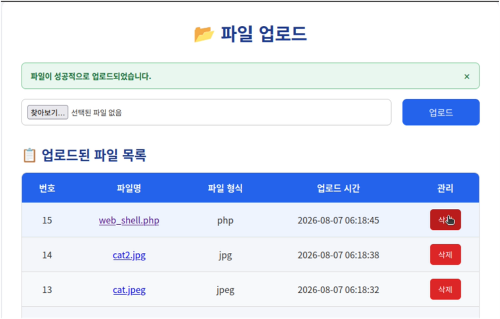
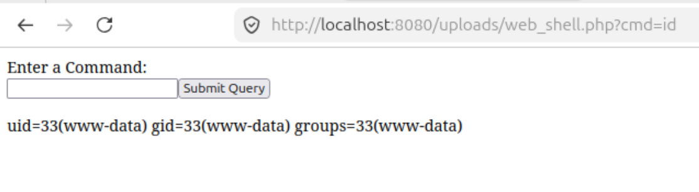

---
title: "2026 Summer Sprint Camp 웹 보안 프로젝트"
date: 2026-08-30 12:00:00 +0900
categories: ["개발"]
tags: [PHP, Docker, Web Security, SQL Injection, Web Shell, File Upload, Secure Coding]
---

## 1. 프로젝트 개요

2026 Summer Sprint Camp에서 여름방학 기간동안 동기들과 함께 웹 보안 프로젝트를 진행했다. 취약한 웹사이트를 직접 개발하고 SQL Injection과 웹셸 업로드 공격을 실습한 뒤 각각의 취약점을 개선하는 방어 코드를 작성했다.

또한 취약한 코드와 수정한 코드를 비교하고 웹 보안 개념과 시큐어 코딩 방법을 설명하는 웹사이트를 제작했다.

이번 프로젝트에서는 관리자 계정 관련 기능과 파일 업로드 기능 구현을 담당했으며 SQL Injection 공격 실습과 웹셸 업로드 공격 실습에 참여했다.

## 2. 개발 환경

| 구분 | 사용 기술 |
|---|---|
| 백엔드 | PHP |
| 프론트엔드 | HTML, CSS, JavaScript |
| 데이터베이스 | SQL 기반 데이터베이스 |
| 웹 서버 | Apache |
| 실행 환경 | Docker, Docker Compose |
| 버전 관리 | Git, GitHub |

## 3. 주요 기능

| 기능 | 설명 |
|---|---|
| 회원가입 | 사용자 계정 등록 |
| 로그인 및 로그아웃 | 사용자 인증 및 로그인 상태 관리 |
| 관리자 페이지 | 사용자 계정 관리 및 삭제 |
| 파일 업로드 | 파일 업로드 및 검증 |
| 파일 관리 | 업로드된 파일 목록 조회 및 삭제 |
| 시큐어 코딩 | 웹 취약점과 공격 및 방어 방법 설명 |

## 4. 프로젝트 구조

- `assets/` : 이미지 리소스
- `auth/` : 사용자 인증 및 권한 관리
- `config/` : 데이터베이스 연결 설정
- `db/` : 데이터베이스 초기화 스크립트
- `upload/` : 파일 업로드 및 관리 관련 코드
- `uploads/` : 업로드된 파일 저장
- `css/` : 웹페이지 스타일 설정
- `js/` : 업로드 알림 UI
- `Dockerfile` : PHP 및 Apache 실행 환경 설정
- `docker-compose.yml` : Docker 실행 환경 구성
- `secure_coding.php` : 시큐어 코딩 안내 페이지

기능별로 디렉터리를 구분하여 사용자 인증, 데이터베이스 연결, 파일 업로드 등의 기능을 관리할 수 있도록 구성했다.

## 5. 개발 및 보안 실습 과정

### 5.1. 관리자 계정 관련 기능 구현

관리자 계정 관련 기능과 사용자 계정을 관리할 수 있는 기능을 구현했다.

일반 사용자와 관리자의 권한을 구분하고 관리자만 특정 기능을 수행할 수 있도록 권한을 확인하는 과정이 필요했다.

이를 통해 실행 권한의 부여와 권한 검증의 중요성을 알 수 있었다.

### 5.2. SQL Injection 공격 실습

SQL Injection은 사용자의 입력값이 SQL 쿼리에 안전하지 않은 방식으로 포함될 때 발생하는 취약점이다. 공격자가 SQL 쿼리의 구조를 변경하여 인증을 우회하거나 데이터베이스에 비정상적으로 접근할 수 있다.

직접 개발한 웹사이트를 대상으로 UNION 기반 SQL Injection 공격을 실습했다.

**실습에 사용한 공격 구문**

```sql
' UNION SELECT 1, 'admin', '1234', 'admin' --
```

UNION을 이용하여 기존 쿼리의 결과에 별도의 데이터를 결합하고 주석 기호를 통해 뒤에 이어지는 쿼리의 영향을 제거하는 방식이다.

해당 구문을 사용하여 SQL Injection 공격에 성공했으며 사용자 입력값을 안전하게 처리하지 않을 경우 인증 과정에서 보안 문제가 발생할 수 있음을 확인했다.

SQL Injection 공격 실습에는 직접 참여했으며 이후 취약점을 개선하는 방어 코드 작성은 다른 팀원이 담당했다.

### 5.3. 웹셸 업로드 공격 실습 및 취약점 개선

웹셸(Web Shell)은 웹 서버에서 실행되어 서버에 명령을 전달하거나 파일을 조작할 수 있는 스크립트이다.

파일 업로드 기능에 취약점이 존재할 경우 악성 스크립트가 서버에 업로드되고 실행되어 공격자가 서버에 명령을 전달할 수 있다.

#### (1) 웹셸 파일

실습에는 PHP로 작성된 `web_shell.php` 파일을 사용했다.

해당 파일은 HTML 입력 폼을 통해 사용자로부터 명령어를 전달받고 서버에서 명령어를 실행한 뒤 그 결과를 웹페이지에 출력하는 구조이다.

**주요 코드 구성**

| 구성 요소 | 역할 |
|---|---|
| `echo` | 명령어 입력 폼 출력 |
| `$_GET` | 사용자 입력값 전달받기 |
| `isset()` | 입력값의 존재 여부 확인 |
| `system()` | 운영체제 명령 실행 |

사용자의 입력값이 별도의 검증 없이 운영체제 명령 실행에 사용되기 때문에 웹 서버 계정의 권한으로 명령을 실행할 수 있다.

해당 파일은 직접 구축한 로컬 실습 환경에서 파일 업로드 취약점의 위험성을 확인하기 위해 사용했다.

[웹셸 실습 프로젝트 GitHub Repository](https://github.com/elowennox/web_shell_test)

#### (2) 웹셸 파일 업로드

직접 구현한 파일 업로드 기능을 대상으로 웹셸 업로드 공격을 실습했다.



*그림 1. 웹셸 파일 업로드 성공*

위 화면에서 확인할 수 있듯이 일반 이미지 파일뿐만 아니라 실행 가능한 PHP 파일인 `web_shell.php`도 정상적으로 업로드되었다.

#### (3) 서버 명령 실행 및 권한 확인

업로드된 웹셸을 통해 서버에서 명령을 실행하고 현재 사용자의 권한을 확인했다.



*그림 2. 웹셸을 통한 서버 명령 실행 및 사용자 권한 확인*

`id` 명령어를 실행한 결과는 다음과 같다.

```
uid=33(www-data) gid=33(www-data) groups=33(www-data)
```

`www-data`는 웹 서버 실행에 사용되는 계정으로 해당 결과를 통해 웹 서버 계정의 권한으로 명령을 실행할 수 있음을 확인했다.

root 권한을 획득한 것은 아니지만 시스템에 잘못된 파일 권한이나 취약한 권한 설정이 존재할 경우 추가적인 권한 상승으로 이어질 가능성이 있다.

이를 통해 파일 업로드 취약점이 단순히 악성 파일을 저장하는 문제에 그치지 않고 서버의 명령 실행으로 이어질 수 있다는 것을 확인했다.

#### (4) 취약점 원인 분석

파일 업로드 기능을 구현하면서 단순히 파일의 확장자를 검사하는 것만으로는 충분한 방어가 되지 않는다는 것을 알게 되었다.

파일의 확장자는 사용자가 변경할 수 있기 때문에 확장자만으로는 파일의 실제 유형이나 안전성을 판단하기 어렵다.

따라서 파일 업로드 과정에서 파일의 유형과 크기 등 여러 요소를 함께 검증할 필요가 있다고 판단했다.

#### (5) 취약점 개선

파일 업로드 기능의 보안성을 높이기 위해 다음과 같은 검증 방식을 적용했다.

| 검증 방식 | 목적 |
|---|---|
| 파일 확장자 검증 | 허용되지 않은 확장자의 파일 제한 |
| 파일 크기 제한 | 과도하게 큰 파일의 업로드 방지 |
| MIME 타입 검증 | 파일의 실제 유형 확인 |

파일명이나 확장자에만 의존하지 않고 파일의 유형과 크기 등을 함께 확인하도록 개선했다.

다만 이러한 검증만으로 모든 웹셸 업로드 공격을 방어할 수 있는 것은 아니다. 업로드 경로의 스크립트 실행 제한과 안전한 파일 저장 방식 등도 함께 고려해야 한다.

### 5.4. 시큐어 코딩 안내 페이지 제작

프로젝트에서 실습한 웹 취약점과 방어 방법을 정리하고 취약한 코드와 수정한 코드를 비교할 수 있는 웹페이지를 팀원들과 함께 제작했다.

공격이 가능한 이유와 코드에서 문제가 발생하는 부분, 이를 개선하는 방법을 정리하면서 시큐어 코딩의 중요성을 학습했다.

## 6. 배운 점 및 느낀 점

이번 프로젝트를 통해 프로그램의 기능을 정상적으로 구현하는 것과 안전하게 구현하는 것의 차이를 알게 되었다.

특히 파일 업로드 기능을 구현하면서 단순한 확장자 검사만으로는 충분한 보안을 보장할 수 없다는 점을 검증해볼 수 있었다. 직접 공격을 시도하고 취약점의 발생 원인을 확인한 뒤 방어 코드를 작성하면서 공격과 방어를 함께 고려하는 것이 중요함을 느꼈다.

또한 팀원들과 함께 프로젝트를 진행하며 각자 담당한 기능과 학습한 내용을 공유하고 서로 다른 취약점에 대해 공부할 수 있었다.

앞으로도 다양한 기능 구현과 실제 공격 가능성에 대처할 수 있는 방법 방법을 다루는 프로젝트를 좀 더 심화하여 진행해보고 싶다.

## 7. GitHub Repository

[2026 Summer Sprint Camp 프로젝트 소스 코드](https://github.com/elowennox/2026-summer-sprint-camp)
